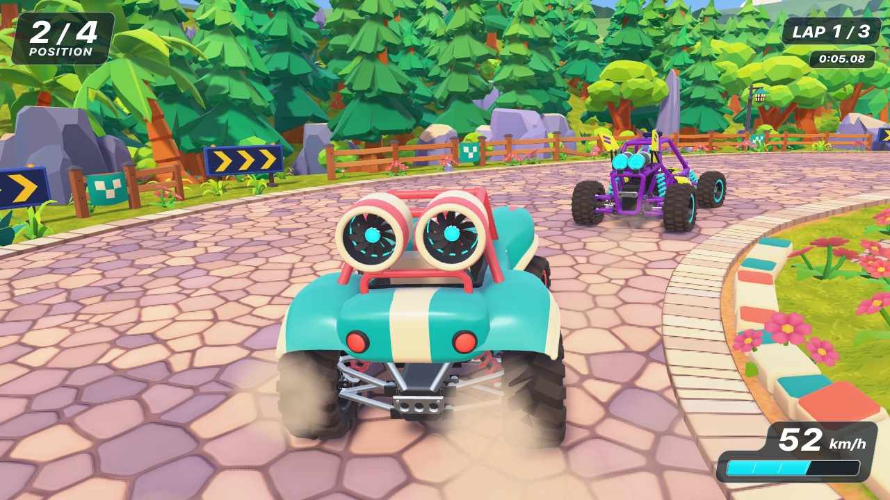
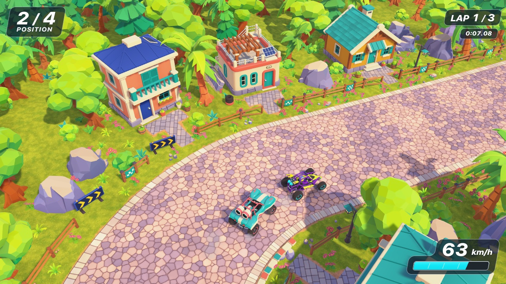

# Web Racer

A toy-buggy racing game that runs in the browser. You race a small off-road
buggy against three computer-driven rivals around a hand-sized world of dirt
roads, cobbled villages and palm trees. Every world is generated from a seed
number, so there is always a new track to try.

**[▶ Play it in your browser](https://multimike.github.io/web-racer/)**

<p>
  
  
</p>

The game is made for a desktop browser with a keyboard or a gamepad. A
tabletop view for the Meta Quest 3 is in the works; today it can be previewed
on a flat screen with `?view=xr`.

## Controls

| | Keyboard | Gamepad |
|---|---|---|
| Steer | A / D or ← / → | Left stick |
| Throttle | W or ↑ | Right trigger |
| Brake, hold to reverse | S or ↓ | Left trigger |
| Put the car back on the road | R | Circle / B |
| Change camera | C | Triangle / Y |
| Restart the race | Enter | Options / Start |

Click the page or press a key once to switch the engine sound on.

## Options

Add options to the address, for example
[`?seed=42&car=comet-fox`](https://multimike.github.io/web-racer/?seed=42&car=comet-fox).

| Option | Values | What it does |
|---|---|---|
| `seed` | any whole number from 1 (default 16) | Picks the world and track. The same number always gives the same world. |
| `car` | `reef-rocket`, `neon-wasp`, `riot-ram`, `comet-fox` | Your car |
| `livery` | 0, 1, 2 … | Your car's paint |
| `difficulty` | `easy`, `normal`, `hard` | How quick the rivals are |
| `rivals` | 0 to 3 | Number of rivals |
| `laps` | 0 to 99 (default 3) | Race length; 0 is endless |
| `view` | `chase`, `high`, `xr` | Starting camera |

## Run it yourself

You need [Node.js](https://nodejs.org) 22.18 or newer.

```bash
npm install
npm run dev
```

Then open the address the dev server prints. `npm run build` puts a
ready-to-host copy in `dist/`.

## How it is made

Everything you see is built in code when the game loads: the cars, buildings,
trees, the ground textures and the track. There are no model or image files.
It is written in TypeScript with [Babylon.js](https://www.babylonjs.com) for
graphics and [Havok](https://www.havok.com) for physics.

## Design documents

The game is modelled on a set of design sheets, kept in
[`design-documents/`](design-documents/). Each pack holds the pictures plus a
written brief per item.

| Pack | What is in it |
|---|---|
| [Gameplay vision](design-documents/gameplay-vision/) | The two target pictures for the look: the [chase camera](design-documents/gameplay-vision/village-race-gameplay-vision.png) and the [high camera](design-documents/gameplay-vision/village-race-elevated-camera.png) |
| [Buggies](design-documents/buggy-design-pack/) | The four cars: [Reef Rocket](design-documents/buggy-design-pack/reef-rocket/turnaround.png), [Neon Wasp](design-documents/buggy-design-pack/neon-wasp/turnaround.png), [Riot Ram](design-documents/buggy-design-pack/riot-ram/turnaround.png) and [Comet Fox](design-documents/buggy-design-pack/comet-fox/turnaround.png) |
| [Buildings](design-documents/building-design-pack/) | [Shacks](design-documents/building-design-pack/shacks/design-sheet.png), [houses](design-documents/building-design-pack/houses/design-sheet.png), [village services](design-documents/building-design-pack/village-services/design-sheet.png) and [landmarks](design-documents/building-design-pack/village-landmarks/design-sheet.png) |
| [Environment](design-documents/environment-design-pack/) | [Trees](design-documents/environment-design-pack/trees/design-sheet.png), [plants](design-documents/environment-design-pack/vegetation/design-sheet.png), [large rocks](design-documents/environment-design-pack/large-rocks/design-sheet.png) and [small rocks](design-documents/environment-design-pack/small-rocks/design-sheet.png) |
| [Ground materials](design-documents/ground-material-pack/) | Notes and the generator script for the reference ground textures. The texture images themselves are not in this repository. |
